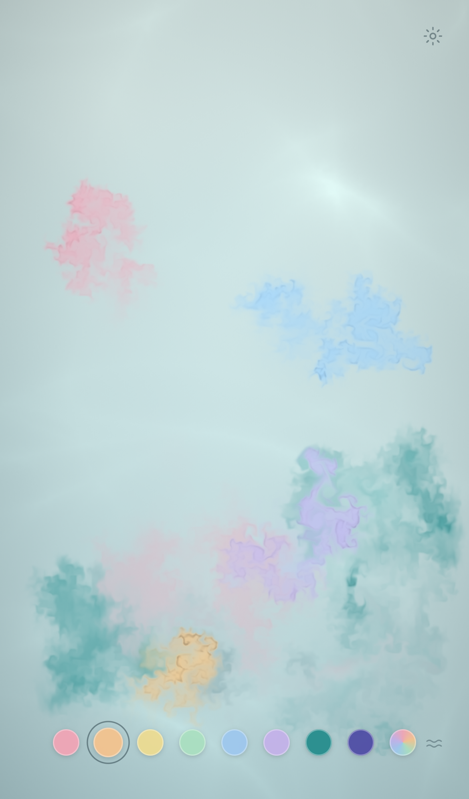
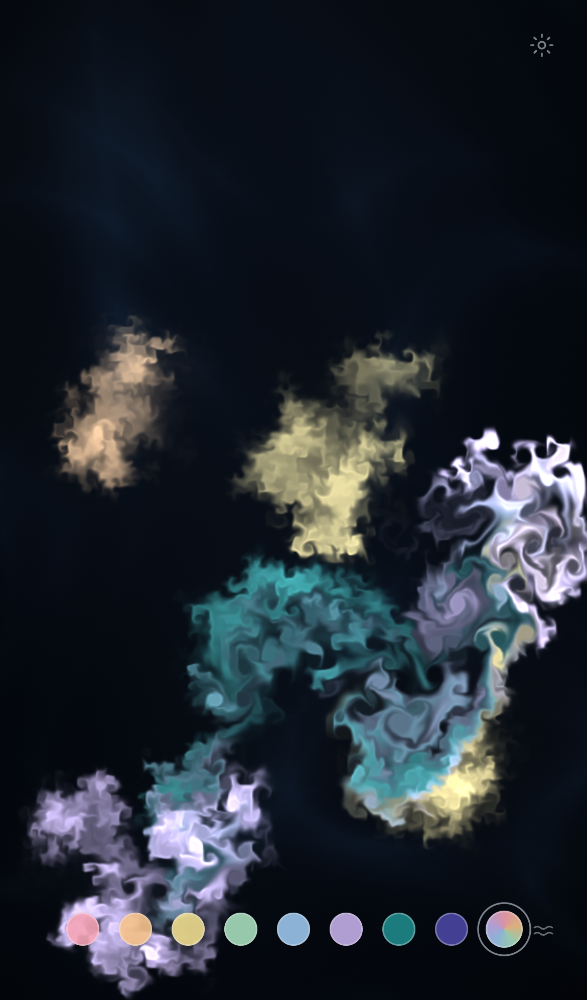

# Ink Bloom

A small, meditative web toy: watch ink slowly bloom and fade in still water. No score, no goals, almost no UI.

- **Tap** to drop ink · **hold and drag** for a stream
- **Color dots** along the bottom (plus random) · **swipe up** on the bar or tap ≈ to clear
- **Long-press** empty water to pause, tap to resume
- **Settings** (top right): Pond / Night scene, sound, ambient water, slow mode
- **Save as wallpaper** (frame icon): freeze the bloom, pick a phone size, and save a UI-free PNG to Photos

Runs as a plain static site (WebGL fluid shader, Canvas2D fallback, Web Audio). On iPhone, use Share → Add to Home Screen for full-screen play.

| Day | Night |
|---|---|
|  |  |
